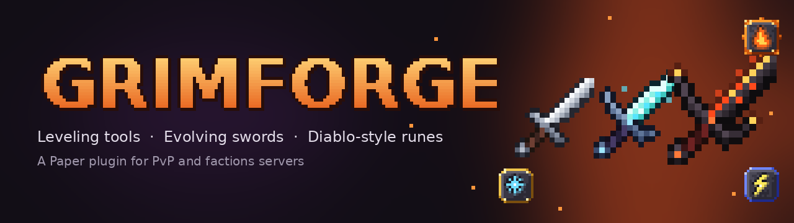

*Mine, fight, level up, socket a rune, then go back for more.*

**Links:** [Guide & source code](https://github.com/Mikeym41/Grimforge) · [Issue tracker](https://github.com/Mikeym41/Grimforge/issues) · [Changelog](https://github.com/Mikeym41/Grimforge/blob/main/CHANGELOG.md)

**Requires:** Paper or Purpur, 1.21.4 to 26.3 (26.x needs Java 25)
**Works with:** FactionsUUID, SaberFactions

## Overview

Grimforge lets you level up your tools, evolve your swords and pry runes off whatever you just killed. Features include:

- Tools that get better the more you use them
- Modifiers to spend your hard-earned levels on
- Swords that look scarier every few levels
- Runes in three tiers, dropped by anything hostile
- Balance tested the hard way, in about 540 duels
- No free XP for farmers

The full numbers live in the [guide](https://github.com/Mikeym41/Grimforge#features).

## Factions Ready

Your runes know who your friends are. Grimforge hooks into FactionsUUID and SaberFactions on its own.

- No rune friendly fire on members, allies or truces
- Storm lightning won't jump to your teammates
- Safezones stay safe

## Installation

Same as any other plugin:

- Drop the jar in `plugins` and restart
- Want the evolving swords? Grab the resource pack from the [latest release](https://github.com/Mikeym41/Grimforge/releases/latest)
- Tweak anything you like in `config.yml`

## Commands

One for players, a few for admins:

- `/tool` or `/gf`: open the forge menu
- `/tool info`: check your tool's level, modifiers and runes
- `/tool addxp`, `/tool rune`, `/tool reload`: admin and testing tools

Permissions are `grimforge.use` (everyone) and `grimforge.admin` (ops).

## What's Next

Grimforge is in beta and still growing. Up next: **Grimforge as a NeoForge mod**, with tools built from parts, real rune items, Rune Words and recipe viewer support. The plugin sticks around for Paper servers.

## License

Grimforge is MIT licensed, so go wild. Put it on your server, toss it in your modpack, no need to ask. Just link back here instead of reuploading the jar, so nobody gets stuck on an old version.

Bugs go on the [issue tracker](https://github.com/Mikeym41/Grimforge/issues), not in the comments. Logs make me happy.

## Credits

- **Mikeym41**: everything, for now
