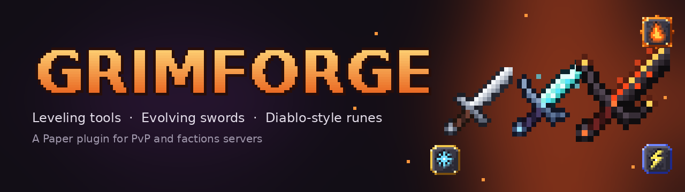
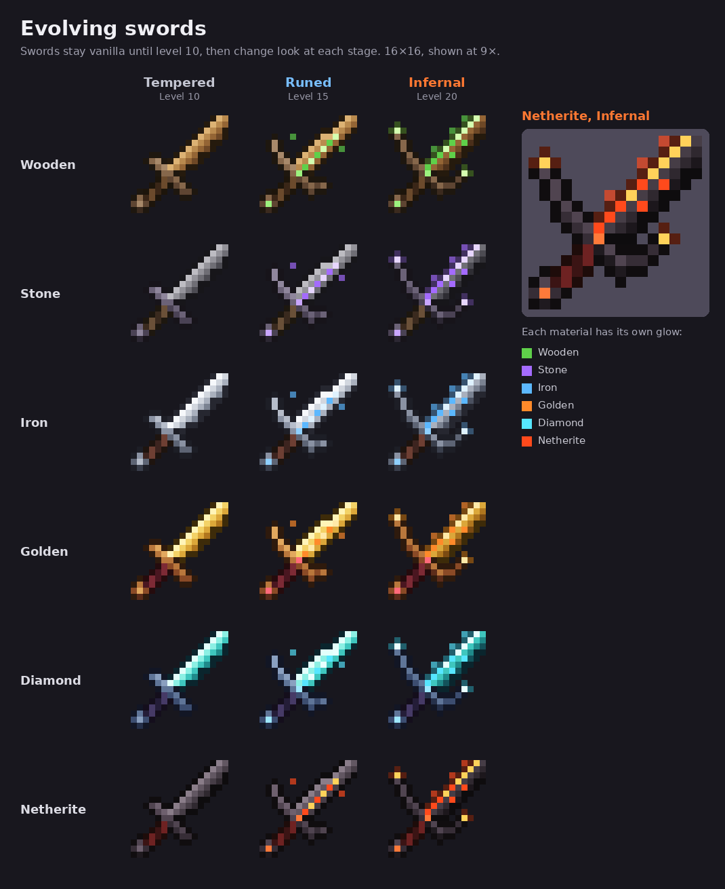
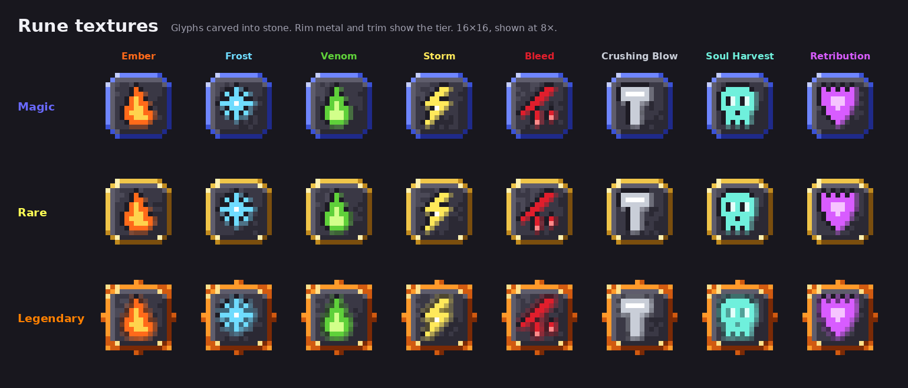
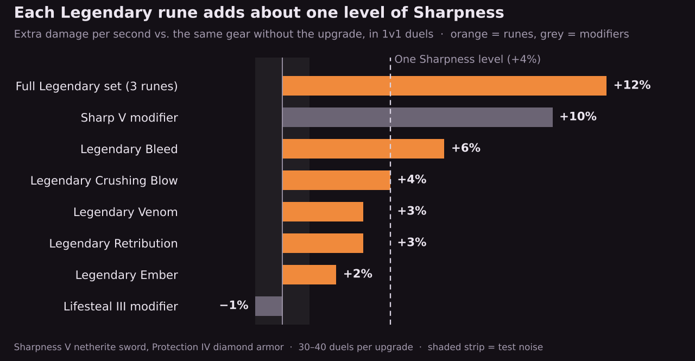

<p align="center">
  
</p>

<p align="center">
  <a href="https://github.com/Mikeym41/grimforge/releases/latest"></a>
  
  
  
  
  <a href="LICENSE"></a>
</p>

<p align="center">
  <a href="#features">Features</a> ·
  <a href="#runes">Runes</a> ·
  <a href="#pvp-balance">PvP balance</a> ·
  <a href="#installation">Installation</a> ·
  <a href="#commands--permissions">Commands</a> ·
  <a href="#configuration">Config</a>
</p>

---

**Grimforge** turns your gear into something you grind for. Tools level up as you use them, swords evolve into demonic blades, and runes drop from monsters to socket into your weapons. It's built for PvP and factions servers, so every number has been tested in 1v1 duels to keep fights fair.

## Features

| | | |
|---|---|---|
|  | **Tools that level up** | Pickaxes, axes, shovels, hoes and swords earn XP from mining, farming and fighting, up to level 20. Each level gives a point to spend on modifiers. |
|  | **Swords that evolve** | Swords change look at levels 10, 15 and 20, from a serrated blade to a molten demon sword. Every material glows its own color. |
|  | **Diablo-style runes** | 8 runes in Magic, Rare and Legendary tiers drop from monsters. Swords and axes unlock up to 3 sockets. |
|  | **Balanced for PvP** | Runes only proc on fully charged hits, have cooldowns, and are capped against players. |
|  | **Factions ready** | Runes never hit your faction, allies or truces, and are off in safezones. Hooks into FactionsUUID and SaberFactions automatically. |
|  | **Farm-proof** | No XP from player-placed blocks, spawner mobs or creative mode. Tracking stays instant even in huge bases. |

## Evolving swords

<p align="center"></p>

| | Level | Stage | Look |
|---|---|---|---|
|  | 10 | **Tempered** | Serrated, battle-worn blade |
|  | 15 | **Runed** | Glowing runes in the fuller, winged guard, set gems |
|  | 20 | **Infernal** | Black blade with a molten edge, burning horns and embers |

Players get a message when their sword evolves. The textures come from the optional [resource pack](#resource-pack); without it, swords keep their vanilla look.

## Modifiers

Every level up gives a modifier point. Spend them in the `/tool` menu.

| Modifier | Tools | Effect |
|---|---|---|
| **Haste** | pickaxe, axe, shovel, hoe | +1 Efficiency per level |
| **Lucky** | pickaxe, axe, shovel, hoe | +1 Fortune per level |
| **Autosmelt** | pickaxe, shovel | Smelts drops (iron ore → iron ingot, sand → glass) |
| **Magnetic** | all | Drops go straight to your inventory |
| **Reinforced** | all | 10% chance per level to skip durability loss |
| **Experienced** | all | +50% XP orbs per level |
| **Sharp** | sword, axe | +1 damage per level (+0.2 against players) |
| **Lifesteal** | sword, axe | Heal 5% of damage dealt per level (2% against players) |

## Runes

<p align="center"></p>

Hostile mobs drop runes in three tiers. Bosses always drop Rare or better.

|  **Magic** |  **Rare** |  **Legendary** |
|:---:|:---:|:---:|
| 2% per kill | 0.5% per kill | 0.1% per kill |

Swords and axes unlock a socket at levels 5, 10 and 15. To socket a rune, open `/tool` and click it in your inventory.

| Rune | What it does | Cooldown |
|---|---|---|
|  **Ember** | Sets your target on fire | 5s |
|  **Frost** | Slows your target | 8s |
|  **Venom** | Poisons your target (can't kill) | 8s |
|  **Storm** | Lightning jumps to nearby enemies | 10s |
|  **Bleed** | Damage over time | 10s |
|  **Crushing Blow** | Bonus damage based on the target's current health | 12s |
|  **Soul Harvest** | Regeneration after a kill | 15s |
|  **Retribution** | Reflects part of the damage you take | 6s |

<details>
<summary><b>Full rune stats by tier</b></summary>

| Rune | Magic / Rare / Legendary |
|---|---|
| Ember | 10/15/20% chance to ignite for 3/4/5s |
| Frost | 10/14/18% chance of Slowness I for 1.5/2/2.5s |
| Venom | 10/14/18% chance of Poison I for 2/3/4s |
| Storm | 8/12/15% chance to arc to 2/3/3 enemies for 2/3/4 damage |
| Bleed | 10/13/16% chance to bleed 1 damage/s for 3/4/5s |
| Crushing Blow | 6/9/12% chance to deal 10/15/20% of current health |
| Soul Harvest | Regeneration I for 3/4/5s after a kill |
| Retribution | 15/20/25% chance to reflect 6/9/12% of incoming damage |

Drop chance per hostile kill: 2% Magic, 0.5% Rare, 0.1% Legendary. Bosses (Wither, Ender Dragon, Warden, Elder Guardian) always drop Rare or Legendary. Spawner mobs drop nothing.

</details>

## PvP balance

<p align="center"></p>

Runes should feel rewarding without making them mandatory. Tested in about 540 1v1 duels with the same gear on both sides, each Legendary rune is worth roughly one extra level of Sharpness, and a full set about three.

- Runes only proc on **fully charged hits**. Spam-clicking does nothing.
- Every rune has its own **cooldown**.
- Rune damage against players is **reduced** (60%), and the big hitters are **capped** at 2 hearts.
- Effects are level I only, poison can't kill, and bleeds don't stack.
- Rune hits never give invulnerability frames, so they never block your next swing.

## Installation

1. Download `Grimforge-0.5.0.jar` from the [latest release](https://github.com/Mikeym41/grimforge/releases/latest).
2. Drop it into your server's `plugins` folder and restart.
3. *(Optional)* Set up the resource pack below for evolving swords and rune textures.

**Requirements:** Paper or Purpur 1.21.4 through 26.3. Servers on 26.x need Java 25. FactionsUUID or SaberFactions is optional and detected automatically.

### Resource pack

`Grimforge-Resource-Pack.zip` (also on the release page) adds the sword and rune textures. To send it to players automatically, host the zip somewhere with a direct download link and add this to `server.properties`:

```properties
resource-pack=https://your-host/Grimforge-Resource-Pack.zip
resource-pack-sha1=<the zip's SHA-1>
```

The pack only changes items Grimforge has tagged, so normal swords and echo shards look the same as always. Without the pack, everything still works with vanilla looks.

## Commands & permissions

| Command | Permission | Description |
|---|---|---|
| `/tool` (or `/gf`) | `grimforge.use` | Open the modifier and rune menu |
| `/tool info` | `grimforge.use` | Show the held tool's level, modifiers and runes |
| `/tool addxp <amount>` | `grimforge.admin` | Add XP to the held tool |
| `/tool rune <type> [tier] [player]` | `grimforge.admin` | Give a rune |
| `/tool socket <type> [tier]` | `grimforge.admin` | Socket a rune straight into the held weapon |
| `/tool setmod <modifier> <level>` | `grimforge.admin` | Set a modifier level without spending points |
| `/tool reload` | `grimforge.admin` | Reload the config |

`grimforge.use` is given to everyone by default. `grimforge.admin` is given to ops.

## Configuration

Everything lives in `plugins/Grimforge/config.yml`. Run `/tool reload` after editing.

<details>
<summary><b>Most useful settings</b></summary>

| Setting | Default | What it does |
|---|---|---|
| `max-level` | `20` | Highest tool level |
| `xp-curve.base` / `xp-curve.multiplier` | `50` / `1.2` | XP needed per level |
| `runes.socket-levels` | `[5, 10, 15]` | Levels that unlock rune sockets |
| `runes.drops.magic` / `rare` / `legendary` | `0.02` / `0.005` / `0.001` | Rune drop chance per hostile kill |
| `runes.pvp.min-attack-charge` | `0.9` | How charged a hit must be to proc |
| `runes.pvp.damage-multiplier` | `0.6` | Rune damage against players |
| `runes.types.<rune>.cooldown` | `5`–`15` | Cooldown per rune, in seconds |
| `visuals.sword-stage-levels` | `[10, 15, 20]` | Levels where swords evolve |
| `factions.enabled` | `true` | Faction-aware runes |
| `factions.truce-is-friendly` | `true` | Treat truces like allies |
| `xp.blocks.ignore-player-placed` | `true` | No XP from blocks players placed |

Every modifier and rune can also be turned off individually with `enabled: false`.

</details>


```

## Roadmap

- [ ] Bows, crossbows, tridents and maces
- [ ] Runewords: bonus effects for specific rune combinations
- [ ] Armor sockets and defensive runes
- [ ] PlaceholderAPI support and a `messages.yml` for translations
- [ ] Per-world toggles

Have an idea or found a bug? [Open an issue](https://github.com/Mikeym41/grimforge/issues).

## License

[MIT](LICENSE) © Mikeym41
